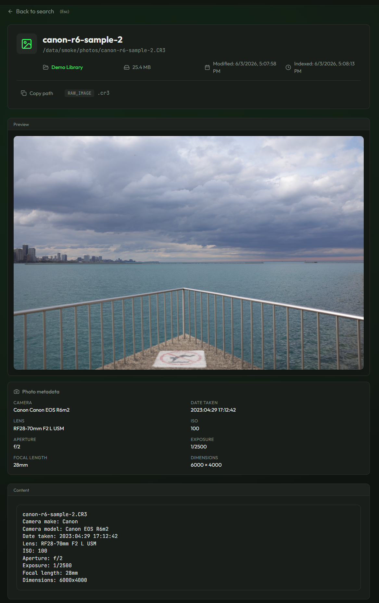
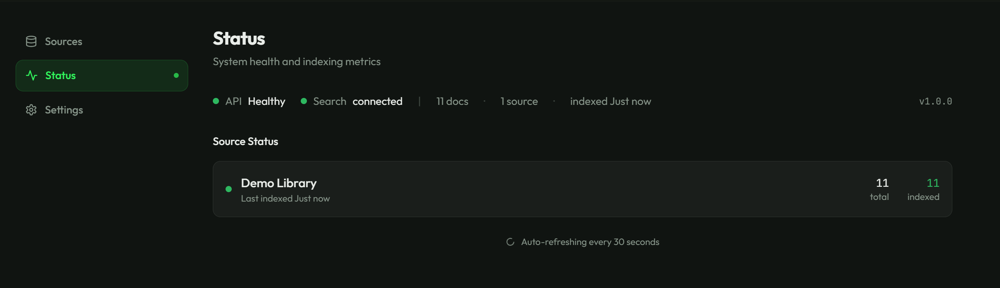

<p align="center">
  
</p>

<p align="center">
  <sub>Logo by <a href="https://www.briefreelancing.com/">Briefreelancing</a>.</sub>
</p>

<h1 align="center">OneSearch</h1>

<p align="center">Search your homelab like you search the web.</p>

<p align="center">
  <a href="https://github.com/demigodmode/OneSearch/releases/latest"></a>
  <a href="https://github.com/demigodmode/OneSearch/stargazers"></a>
  <a href="https://hub.docker.com/r/demigodmode/onesearch"></a>
  <a href="https://pypi.org/project/onesearch-cli/"></a>
  <a href="https://github.com/demigodmode/OneSearch/actions/workflows/backend-tests.yml"></a>
  <a href="https://github.com/demigodmode/OneSearch/actions/workflows/frontend-tests.yml"></a>
  <a href="https://onesearch.readthedocs.io"></a>
  <a href="LICENSE"></a>
</p>

OneSearch indexes your local directories, NAS shares, and external drives and gives you instant full-text search from a browser. It runs in Docker on your own hardware and doesn't send anything to the cloud.

https://github.com/user-attachments/assets/00b47f81-8275-4e49-a40d-a5a820f48726

## Why OneSearch

- It searches the text inside your files, not only their names: PDFs, Word, Excel and PowerPoint, EPUBs, Markdown, code and config files.
- Photos and media are searchable by metadata. Find shots by camera, lens, ISO or date taken, and music or video by artist, album or codec.
- Your files stay where they are. OneSearch reads them and keeps its own index; it never moves, renames or uploads anything.
- An optional agent indexes other machines, so you don't have to mount their folders on the server.
- Meilisearch runs inside the same container, so the default install is a single container. Each source can have its own scan schedule, and there's a CLI if you'd rather search from a terminal.

## How it compares

[Paperless-ngx](https://docs.paperless-ngx.com/) is a document manager. It imports your documents, OCRs them and files them in its own library. OneSearch leaves files where they are and doesn't do OCR, so for scanned paper Paperless is still the better tool. The two work fine side by side.

[Everything](https://www.voidtools.com/) finds files by name on Windows, and it's very fast at it. OneSearch searches what's inside the files, from any browser.

[Recoll](https://www.recoll.org/) is a good desktop full-text search app. OneSearch is meant to run on a server: one container, a web UI with logins, per-source scan schedules and agents for other machines.

---

## Quick Start

```bash
mkdir onesearch && cd onesearch
curl -O https://raw.githubusercontent.com/demigodmode/OneSearch/main/docker-compose.yml
curl -O https://raw.githubusercontent.com/demigodmode/OneSearch/main/.env.example
cp .env.example .env
```

Edit `.env` and set `MEILI_MASTER_KEY` and `SESSION_SECRET` to two different random strings (`openssl rand -base64 32` works).

```bash
docker compose up -d
```

Open http://localhost:8000, run through the setup wizard, add a directory as a source, and start searching.

Upgrading an existing install? See the [upgrade notes](https://onesearch.readthedocs.io/en/latest/getting-started/upgrading/).

Full setup guide: [onesearch.readthedocs.io](https://onesearch.readthedocs.io/en/latest/getting-started/installation/)

---

## What it indexes

PDFs, Office docs, ebooks and comics, RAW photos, audio and video metadata, subtitles, Markdown, code, config and plain text.

<details>
<summary>All supported formats</summary>

| Type | Formats |
|------|---------|
| Documents | PDF, Word (.docx), Excel (.xlsx), PowerPoint (.pptx), RTF |
| Ebooks & comics | EPUB, CBZ comic archives |
| Images & RAW photos | JPG, PNG, WebP, GIF, TIFF, CR2, CR3, NEF, ARW, RAF, ORF, RW2, DNG |
| Media metadata | MP4, MKV, MOV, AVI, MP3, FLAC, M4A, OGG, WAV |
| Subtitles | SRT, WebVTT, ASS/SSA |
| Markdown | .md, .markdown |
| Code | .py, .js, .ts, .go, .rs, .java, .c, .cpp, .sh, .sql, [and more](https://onesearch.readthedocs.io/en/latest/supported-formats/text-files/) |
| Config | .yaml, .toml, .json, .xml, .ini, .env, [and more](https://onesearch.readthedocs.io/en/latest/supported-formats/text-files/) |
| Text | .txt, .log |

</details>

Incremental indexing so only changed files get reindexed. Each source can scan on its own interval or cron schedule, or follow one global default, so your NAS gets scanned daily without thinking about it.

### Remote sources

Optional remote agents can index files on another machine without mounting its directories on the OneSearch server. Local read-only NFS, SMB, bind, and ZFS mounts remain the default and need no agent. See the [remote-agent guide](docs/administration/remote-agents.md).

---

## Screenshots

| Search RAW photo metadata | Source health and indexing status |
|---|---|
|  |  |

---

## Documentation

**[onesearch.readthedocs.io](https://onesearch.readthedocs.io)**

- [Installation Guide](https://onesearch.readthedocs.io/en/latest/getting-started/installation/)
- [User Guide](https://onesearch.readthedocs.io/en/latest/user-guide/)
- [CLI Reference](https://onesearch.readthedocs.io/en/latest/cli/) - standalone `onesearch-cli` package that connects to your running OneSearch server and ships from the same tagged release as the Docker image
- [API Reference](https://onesearch.readthedocs.io/en/latest/api/)

---

## Development

```bash
git clone https://github.com/demigodmode/OneSearch.git
cd OneSearch
```

See the [Development Guide](https://onesearch.readthedocs.io/en/latest/development/) for setup instructions.

---

## License

[AGPL-3.0](LICENSE). Free to use, modify, and distribute. If you deploy a modified version as a network service, source must be made available.

---

## Support

- [GitHub Issues](https://github.com/demigodmode/OneSearch/issues) - bugs and feature requests
- [GitHub Discussions](https://github.com/demigodmode/OneSearch/discussions) - questions and ideas
- [Documentation](https://onesearch.readthedocs.io) - guides and reference
